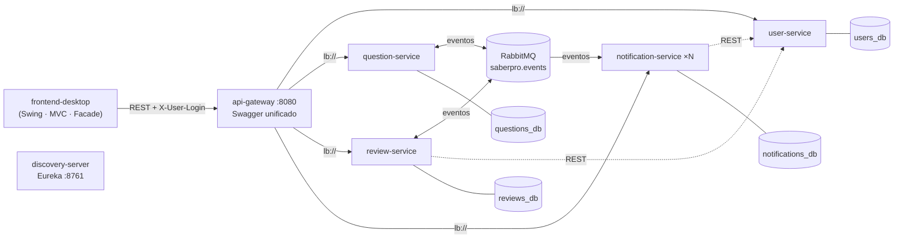

# Banco de Preguntas Saber PRO — Iteración 2

**Ingeniería de Software II · Universidad del Cauca · 2026.2**

Refactorización del monolito de la iteración 1 hacia una **arquitectura de microservicios orientada a eventos**. El objetivo es garantizar la **escalabilidad** sin perder la **modificabilidad** que se logró en el primer corte.

> Documento de arquitectura completo: [`docs/ARQUITECTURA.md`](docs/ARQUITECTURA.md)



## Historias de usuario

| HU | Descripción | Servicio | Endpoint principal |
|----|-------------|----------|--------------------|
| HU01 | Crear pregunta de selección múltiple con única respuesta y validación estructural | question-service | `POST /api/questions` |
| HU02 | Cambiar de *Borrador* a *Pendiente de revisión*, con estados en colores | question-service | `POST /api/questions/{id}/submit-for-review` |
| HU03 | Listar mis preguntas con paginación y filtros, y editarlas | question-service | `GET /api/questions?author=…` · `PUT /api/questions/{id}` |
| HU04 | El administrador asigna **entre 1 y 3** revisores, que reciben un correo | review-service + notification-service | `POST /api/reviews/{id}/reviewers` |
| **HU05** | El revisor lista sus preguntas asignadas, las evalúa, deja observaciones y las aprueba o rechaza, con notificación a los implicados | review-service + question-service + notification-service | `GET /api/reviews/assigned` · `POST /api/reviews/{id}/evaluations` |

## Módulos

| Módulo | Puerto | Responsabilidad |
|--------|--------|-----------------|
| `common-events` | — | Contratos de eventos (*Published Language*). Es Java puro, sin framework. |
| `discovery-server` | 8761 | Eureka: registro y descubrimiento de instancias. |
| `api-gateway` | 8080 | Punto único de entrada, balanceo `lb://` y Swagger UI que agrupa las 4 APIs. |
| `user-service` | 8081* | Contexto *Identity & Access*. |
| `question-service` | 8082* | Contextos *Gestión de Preguntas*, *Ciclo de Vida* y *Validación Estructural*. |
| `review-service` | 8083* | Contexto *Revisión por Pares*. |
| `notification-service` | 8084* | Contexto de soporte *Notificaciones*. Es stateless respecto a los mensajes y escala horizontalmente. |
| `frontend-desktop` | — | Cliente Java Swing con MVC. Solo conoce la URL del gateway. |

\* Solo cuando se ejecutan en local. En Docker no se publican, y se accede a ellos únicamente a través del gateway, lo que permite escalarlos.

Cada servicio sigue una **arquitectura hexagonal** con tres paquetes:

- `domain`: entidades y reglas, en Java puro.
- `application`: casos de uso y puertos.
- `infrastructure`: adaptadores REST, JPA, RabbitMQ y clientes REST.

## Ejecución

Requisitos: **JDK 17+**, **Maven 3.9+** y **Docker** con Docker Compose.

### Opción A: todo en Docker (recomendada para la demo)

```bash
mvn clean package -DskipTests          # genera los .jar de cada servicio
docker compose up --build -d           # RabbitMQ, PostgreSQL, Eureka, gateway y 4 servicios
mvn -pl frontend-desktop exec:java     # abre el cliente de escritorio
```

Espere unos 40 segundos a que los servicios aparezcan en Eureka antes de iniciar sesión.

### Opción B: servicios desde el IDE

Use H2 en archivo y deje en Docker solo RabbitMQ:

```bash
docker compose up -d rabbitmq
# Ejecutar en este orden: DiscoveryServerApplication, ApiGatewayApplication,
# UserServiceApplication, QuestionServiceApplication, ReviewServiceApplication,
# NotificationServiceApplication, DesktopApp
```

### URLs útiles

| Recurso | URL |
|---------|-----|
| Swagger UI (las 4 APIs, con selector arriba a la derecha) | http://localhost:8080/swagger-ui.html |
| Panel de Eureka (instancias registradas) | http://localhost:8761 |
| Consola de RabbitMQ (colas, mensajes y consumidores) | http://localhost:15672 — guest / guest |
| Correos simulados | carpeta `./outbox/` |

### Usuarios de prueba

| Rol | Login | Clave |
|-----|-------|-------|
| Administrador | `admin` | `Admin123!` |
| Autor | `autor1`, `autor2` | `Autor123!` |
| Revisor | `rev1`, `rev2`, `rev3` | `Revisor123!` |

### Correo real (opcional)

Copie `.env.example` como `.env` y complete los datos de una cuenta de Gmail con *contraseña de aplicación*.

Con `SEED_EMAIL_BASE=equipo@gmail.com`, todos los usuarios de prueba reciben en la misma bandeja (`equipo+rev1@gmail.com`, etc.).

Si no hay configuración de correo, los mensajes se escriben como `.txt` en `./outbox/` y también aparecen en la **bandeja de notificaciones** de la aplicación.

## Escenario de escalabilidad

```bash
# Emular la latencia de un SMTP real y escalar los consumidores
MAIL_SIMULATED_LATENCY_MS=300 docker compose up -d --scale notification-service=3 --scale review-service=2
k6 run docs/carga/k6-escalabilidad.js   # mide p95 y tasa de errores
```

En la consola de RabbitMQ (`notification-service.events`) se observa que la cola se vacía aproximadamente 3 veces más rápido con 3 réplicas. Esto se logra sin cambiar código ni reiniciar los demás servicios. El detalle está en [`docs/ARQUITECTURA.md`](docs/ARQUITECTURA.md#4-escenario-de-calidad-escalabilidad).

## Pruebas

```bash
mvn test
```

Son pruebas unitarias del dominio y de los servicios de aplicación de cada microservicio, más algunas del cliente:

| Módulo | Clases de prueba |
|--------|------------------|
| user-service | `UserTest`, `DefaultPasswordPolicyTest`, `UserServiceTest`, `Pbkdf2PasswordHasherTest` |
| question-service | `QuestionTest`, `QuestionStateTest`, `QuestionValidationChainTest`, `QuestionPluginTest`, `QuestionServiceTest` |
| review-service | `QuestionReviewTest`, `ReviewerAssignmentTest`, `ReviewValueObjectsTest`, `DecisionPolicyTest`, `ReviewServiceTest` |
| notification-service | `NotificationTest`, `NotificationTemplatesTest`, `NotificationServiceTest` |
| frontend-desktop | `ClientLogicTest` |

Las pruebas usan *fakes* en memoria (`testdoubles`) en lugar de mocks. Esto es posible gracias a la inversión de dependencias, porque la aplicación solo depende de puertos.

La colección `postman/BancoPreguntas-Iteracion2.postman_collection.json` recorre HU01 a HU05 de extremo a extremo a través del gateway.

## Patrones de diseño GoF

| Categoría | Patrón | Clase(s) |
|-----------|--------|----------|
| Creacional | Builder | `question-service · Question.Builder` |
| Creacional | Factory Method | `question-service · QuestionTypePlugin.createQuestion()` → `MultipleChoiceQuestionPlugin` |
| Estructural | Adapter | `notification-service · SmtpEmailSenderAdapter`, `OutboxFileEmailSenderAdapter` → `EmailSenderPort` |
| Estructural | Facade | `frontend-desktop · SaberProApiFacade` |
| Comportamiento | State | `question-service · QuestionState` + `DraftState`, `PendingReviewState`, `InReviewState`, `ApprovedState`, `RejectedState` |
| Comportamiento | Strategy | `review-service · DecisionPolicy` → `UnanimousApprovalPolicy`, `MajorityPolicy` |
| Comportamiento (adicional) | Chain of Responsibility | `question-service · QuestionValidationHandler` y sus 5 reglas |
| Comportamiento (adicional) | Template Method | `notification-service · NotificationTemplate` |
| Comportamiento (adicional) | Observer | `frontend-desktop · AppEvents` / `AppObserver` (MVC) |

## Estructura del repositorio

```
├── common-events/          eventos de integración compartidos
├── discovery-server/       Eureka
├── api-gateway/            Spring Cloud Gateway + Swagger
├── user-service/           ┐
├── question-service/       │ domain / application / infrastructure
├── review-service/         │
├── notification-service/   ┘
├── frontend-desktop/       Swing: api (Facade) · model · controller · view
├── docs/
│   ├── ARQUITECTURA.md
│   ├── diagramas/          C4 (PlantUML), contextos, secuencia y clases
│   └── carga/              script k6 del escenario de escalabilidad
├── postman/
├── docker/postgres/        creación de las 4 bases de datos
├── docker-compose.yml
└── Dockerfile              imagen genérica (ARG MODULE)
```

## Enlaces de la entrega

- Video de sustentación (YouTube): _pendiente_
- Tablero del Sprint 2: _pendiente_
