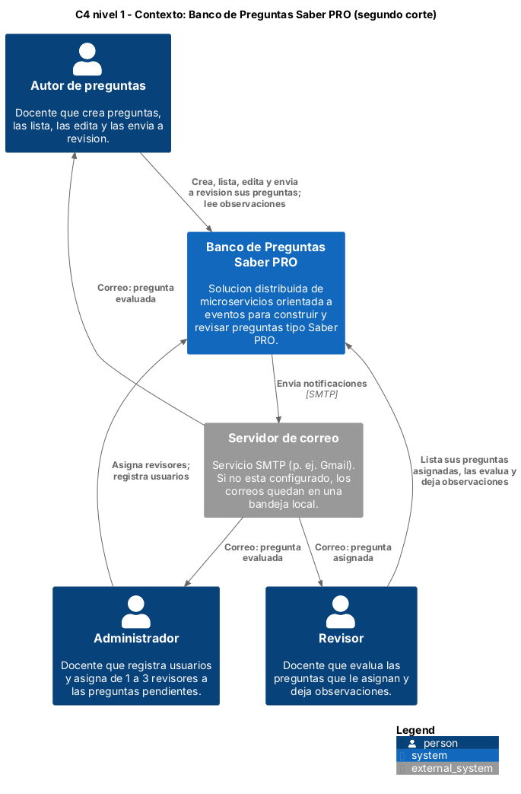
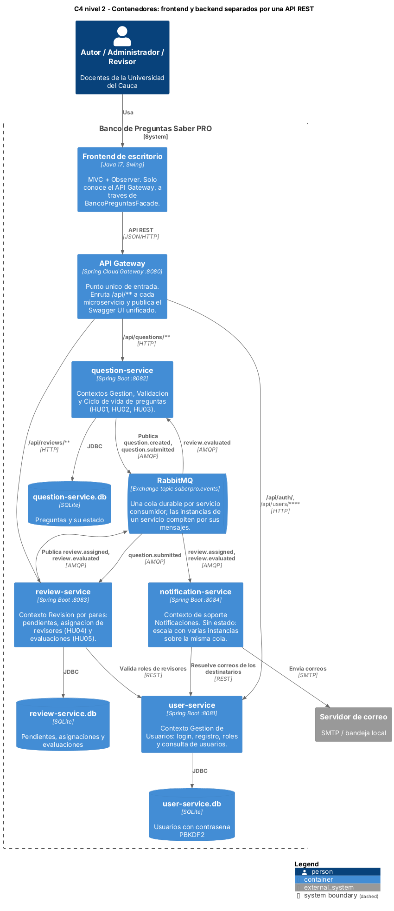
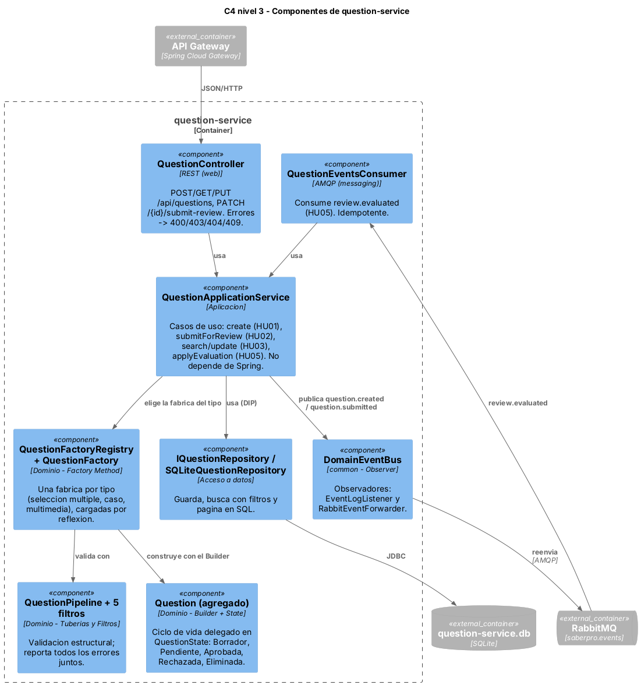
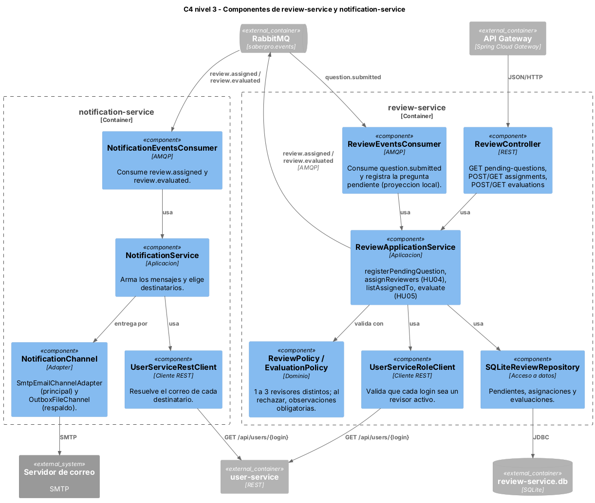
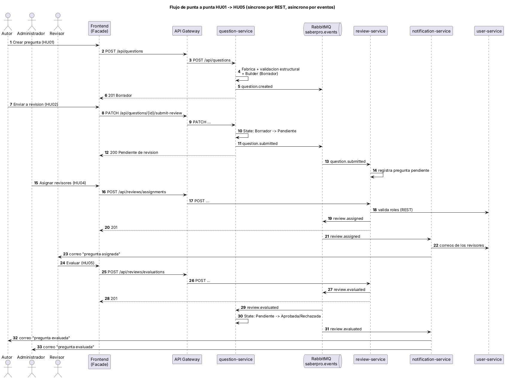
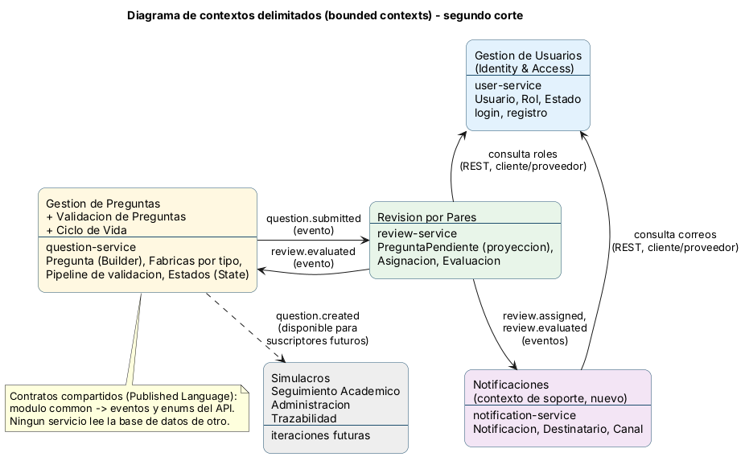
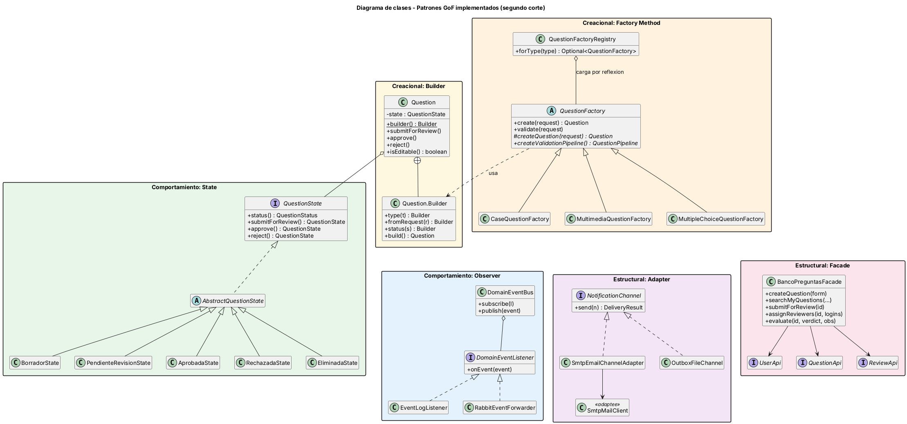

# Portada

**Universidad del Cauca**
Facultad de Ingeniería Electrónica y Telecomunicaciones
Programa de Ingeniería de Sistemas

**Ingeniería de Software II — Teoría y Laboratorio — 2026.2**

## Banco de Preguntas Saber PRO

### Documento de arquitectura — Segundo corte

Refactorización a una solución distribuida con **microservicios** y **arquitectura orientada a eventos** para garantizar la **escalabilidad**.

**Integrantes**

| Integrante | Usuario de GitHub |
|------------|-------------------|
| Oscar Alejandro Menza Chavisnan | `drax2311` |
| Santiago Martínez Grajales | `martinezgrasantiago214` |
| Andrés Felipe Florín Burbano | `andresflorin` |

**Docentes:** Paola Andrea Bedoya, Pablo Magé, W. Libardo Pantoja, Julio Hurtado

Popayán, noviembre de 2026

---

# 1. Introducción

El **Banco de Preguntas Saber PRO** permite a los docentes construir preguntas de selección múltiple con única respuesta, según los principios del Diseño Centrado en Evidencia, y someterlas a una revisión por pares antes de que entren al banco.

En el **primer corte** el sistema era un **monolito de escritorio en capas** (Java Swing, MVC con Observer, Microkernel y Tuberías y Filtros). El atributo de calidad principal era la **modificabilidad**. Ese documento se conserva en [`docs/primer-corte/`](primer-corte/ARQUITECTURA-primer-corte.md).

En este **segundo corte** el sistema se refactoriza a una **solución distribuida de microservicios orientada a eventos**. El atributo de calidad principal pasa a ser la **escalabilidad**:

- El **frontend** (Swing) queda **separado del backend** y se comunica únicamente por una **API REST** a través de un **API Gateway**.
- El backend se divide en **cuatro microservicios**, uno por contexto delimitado. Cada uno tiene **su propia base de datos**.
- Los servicios se avisan los cambios con **eventos en RabbitMQ**. Así ninguno espera a otro para responder, y los que más trabajo reciben se pueden replicar.

Se mantiene lo que funcionó en el primer corte (reglas de negocio, validación estructural, estados con colores, cifrado de contraseñas). Además se aplican **6 patrones GoF**: 2 creacionales, 2 estructurales y 2 de comportamiento.

Este documento presenta:

1. las historias de usuario de la iteración con sus criterios de aceptación,
2. la planificación del Sprint 2,
3. el escenario de calidad de escalabilidad,
4. la arquitectura en el modelo C4 y en UML,
5. el diseño de contextos delimitados,
6. los patrones de diseño implementados y las pruebas automatizadas.

---

# 2. Historias de usuario del segundo corte

Las cinco historias se implementaron dentro de la arquitectura de microservicios. HU05 es la historia nueva de esta iteración. Los criterios de aceptación siguen el formato *Dado / Cuando / Entonces*.

| HU | Jira | Historia | Microservicio(s) | API principal (vía gateway) |
|----|------|--------------------------|------------------------|----------------------------------|
| HU01 | PSP-6 | Crear preguntas | question-service | `POST /api/questions` |
| HU02 | PSP-8 | Cambiar el estado a Pendiente de revisión | question-service → review-service | `PATCH /api/questions/{id}/submit-review` |
| HU03 | PSP-9 | Listar, buscar, filtrar y editar mis preguntas | question-service | `GET /api/questions`, `PUT /api/questions/{id}` |
| HU04 | PSP-11 | Asignar revisores y notificar | review-service → notification-service | `POST /api/reviews/assignments` |
| HU05 | PSP-44 | Listar y evaluar preguntas asignadas (**nueva**) | review-service → question-service, notification-service | `GET /api/reviews/assignments`, `POST /api/reviews/evaluations` |

## HU01 — Crear preguntas (autor)

> *Yo como autor de preguntas necesito crear preguntas de selección múltiple con única respuesta acorde a los principios del Diseño Centrado en Evidencia, para alimentar el banco de preguntas Saber PRO.*

| # | Criterio de aceptación |
|---|------------------------|
| CA1 | **Dado** un autor autenticado, **cuando** abre "Crear pregunta", **entonces** registra contexto, pregunta directa, cuatro opciones, respuesta correcta, justificación, bibliografía, competencia, tema, subtema y nivel de dificultad. |
| CA2 | **Dada** una pregunta completa y consistente, **cuando** la guarda, **entonces** queda almacenada en estado **Borrador**, asociada al autor. Se responde 201 y se publica el evento `question.created`. |
| CA3 | **Dada** una pregunta inválida, **cuando** la guarda, **entonces** el sistema aplica la **validación estructural**, no la guarda y responde **400 con todos los errores juntos**, que el formulario muestra como lista. |
| CA4 | La validación rechaza: contexto vacío; pregunta directa de menos de 10 caracteres; un número de opciones distinto de 4; opciones vacías o repetidas (sin distinguir mayúsculas ni espacios); respuesta correcta que no sea una de las opciones; clasificación incompleta; justificación, bibliografía o autor vacíos. |
| CA5 | La respuesta correcta se elige entre las opciones escritas y se guarda escrita igual que su opción. |

## HU02 — Cambiar el estado de la pregunta (autor)

> *Yo como autor de preguntas necesito cambiar el estado de mis preguntas de "Borrador" a "Pendiente de revisión" para que el administrador les asigne al menos un revisor.*

| # | Criterio de aceptación |
|---|------------------------|
| CA1 | **Borrador** es el estado inicial de toda pregunta. |
| CA2 | **Dada** una pregunta propia en Borrador, **cuando** el autor pulsa "Enviar a revisión" y confirma, **entonces** pasa a **Pendiente de revisión** y se publica `question.submitted`. El review-service la registra como pendiente de asignar. |
| CA3 | **Dado** un usuario que no es el autor, **cuando** intenta enviarla, **entonces** se responde **403**. |
| CA4 | **Dada** una pregunta que no está en Borrador, **cuando** se intenta enviar, **entonces** el patrón State lo impide y se responde **409** con el motivo. |
| CA5 | Cada estado se ve con su color, con una leyenda: Borrador (amarillo), Pendiente de revisión (azul), Aprobada (verde), Rechazada (rojo). La tabla se refresca sola (Observer). |

## HU03 — Listar las preguntas creadas (autor)

> *Yo como autor de preguntas necesito listar las preguntas que he creado para poder más adelante verlas y editarlas.*

| # | Criterio de aceptación |
|---|------------------------|
| CA1 | El autor ve **solo sus** preguntas, de la más reciente a la más antigua, con el estado en color. |
| CA2 | Puede **buscar** por palabra clave en el enunciado, el contexto y el tema. |
| CA3 | Puede **filtrar** por estado y por tema, combinar los filtros con la búsqueda y limpiarlos. Si no hay resultados se muestra un mensaje. |
| CA4 | El listado está **paginado** (5, 10 o 20 por página; máximo 50 en el API), con "Página X de Y" y los botones desactivados en los extremos. |
| CA5 | Puede ver el **detalle** completo, con la respuesta correcta marcada. |
| CA6 | Puede **editar** solo sus preguntas en **Borrador**. Si no es el autor, se responde 403; si no está en Borrador, 409. Los cambios pasan por la misma validación de HU01. |

## HU04 — Asignar revisores (administrador)

> *Yo como administrador necesito asignar revisores (entre 1 y 3) de las preguntas en estado "Pendiente de revisión" para que las preguntas sean revisadas por otros docentes.*

| # | Criterio de aceptación |
|---|------------------------|
| CA1 | El administrador ve las preguntas en estado **Pendiente de revisión**, que el review-service conoce por el evento `question.submitted`. |
| CA2 | Selecciona **entre 1 y 3** revisores distintos que existan y tengan rol Revisor; fuera de ese rango se responde 400. |
| CA3 | La asignación queda registrada en el review-service y se publica `review.assigned`. |
| CA4 | El notification-service **envía un correo** a cada revisor asignado. Si no hay SMTP configurado, el correo queda en la bandeja local. |

## HU05 — Listar y evaluar preguntas asignadas (revisor) — *nueva*

> *Yo como revisor de preguntas necesito listar las preguntas que me han sido asignadas por el administrador para poder leerlas, dejar la evaluación y cambiar el estado a Aprobada/Rechazada.*

| # | Criterio de aceptación |
|---|------------------------|
| CA1 | El revisor ve **solo** las preguntas que le asignaron. |
| CA2 | Puede abrir una pregunta y leer todo su contenido: contexto, pregunta directa, opciones, respuesta correcta, justificación, bibliografía y clasificación. |
| CA3 | Registra su evaluación con veredicto **Aprobada** o **Rechazada**. Al rechazar, las **observaciones** son obligatorias (máximo 2000 caracteres). |
| CA4 | Solo se evalúa una pregunta **asignada al revisor** y en **Pendiente de revisión**. El primer revisor asignado que evalúa decide el estado. |
| CA5 | Se publica `review.evaluated`: el question-service cambia el estado (patrón State) y el notification-service **notifica al autor y al administrador**. |
| CA6 | El autor lee las observaciones en el detalle de su pregunta. Los estados se ven con colores, igual que en el resto del sistema. |

---

# 3. Planificación del Sprint 2

**Sprint 2** en Jira (proyecto *Pruebas Saber Pro*, PSP), del **9 al 30 de octubre de 2026**. Objetivo: *completar las historias de usuario listadas en este sprint.*

> **[Pegar aquí el pantallazo del tablero del Sprint 2 en Jira]**

Historias del sprint, tomadas de Jira:

| Historia | Resumen | Responsable | Subtareas | Estado |
|----------|---------|-------------|-----------|--------|
| PSP-6 | HU01 Crear preguntas | Oscar Menza | PSP-14 a PSP-19 | Listo |
| PSP-8 | HU02 Cambiar estado de la pregunta | Santiago Martínez | PSP-20 a PSP-23 | Listo |
| PSP-9 | HU03 Listar preguntas creadas | Santiago Martínez | PSP-24 a PSP-29 | Listo |
| PSP-11 | HU04 Asignar revisores | Andrés Florín | PSP-30 a PSP-35 | Listo |
| PSP-44 | HU05 Listar y evaluar preguntas asignadas | Oscar Menza | PSP-45 a PSP-50 | Listo |

Cada subtarea de Jira tiene un issue espejo en GitHub. Los pull requests los cierran con `Closes #N`, así el tablero y el repositorio quedan sincronizados.

---

# 4. Escenario de calidad: escalabilidad

**Contexto.** Durante las convocatorias, muchos docentes envían preguntas a revisión al mismo tiempo. Cada envío desencadena una cadena de trabajo: el review-service registra la pregunta, el administrador asigna revisores y se envían correos a cada revisor; luego cada evaluación genera correos al autor y al administrador. Enviar un correo por SMTP es la operación más lenta del sistema (cientos de milisegundos a varios segundos). En el monolito del primer corte, la ventana del administrador quedaba bloqueada mientras se enviaban los correos.

| Parte | Descripción |
|-------|-------------|
| **Fuente del estímulo** | Administradores y revisores trabajando a la vez durante una convocatoria. |
| **Estímulo** | Pico de **500 asignaciones de revisores en 10 minutos** (≈ 1 por segundo), cada una con hasta 3 revisores. Eso son hasta **1.500 correos**, más los de las evaluaciones. |
| **Artefacto** | notification-service y la cola `notification-service.reviewers-assigned` en RabbitMQ. También review-service, que publica los eventos. |
| **Entorno** | Operación normal, con todos los servicios desplegados con `docker compose`. |
| **Respuesta** | La API responde la asignación **sin esperar a que se envíen los correos**: review-service guarda y publica `review.assigned`. Los correos se procesan de forma asíncrona desde la cola. Si la cola crece, el operador agrega réplicas: `docker compose up --scale notification-service=3`. Las réplicas se conectan a la **misma cola** y **compiten por los mensajes** (*competing consumers*), sin cambiar código ni reiniciar los demás servicios. La cola es durable, así que **ningún mensaje se pierde** mientras tanto. |
| **Medida de la respuesta** | (1) `POST /api/reviews/assignments` responde en menos de **500 ms** (p95) durante el pico, sin importar cuántos correos haya pendientes. (2) El tiempo en vaciar la cola baja casi en proporción al número de réplicas: con 3 réplicas, **≈ 1/3** del tiempo que con 1. (3) **0 mensajes perdidos**: todos los correos quedan entregados o en la bandeja de respaldo. |
| **Resultado esperado** | El sistema absorbe el pico sin bloquear a los usuarios, y la capacidad de notificación crece al agregar réplicas, que es el objetivo de escalabilidad del corte. |

**Cómo se mide en la demo.**

1. Levantar el backend con `docker compose up --build` y abrir la consola de RabbitMQ (`http://localhost:15672`, guest/guest), pestaña *Queues*.
2. Generar el pico de asignaciones con la colección de Postman (*Runner* con iteraciones) o un script. Medir el tiempo de respuesta de `POST /api/reviews/assignments` y observar cuántos mensajes se acumulan en `notification-service.reviewers-assigned`.
3. Repetir con `docker compose up --scale notification-service=3` y comparar cuánto tarda la cola en volver a 0. En la consola se ven 3 *consumers* en la cola.

**Tácticas de arquitectura que lo hacen posible.**

| Táctica | Cómo se aplica |
|---------|----------------|
| Comunicación asíncrona | Eventos en RabbitMQ (exchange *topic* `saberpro.events`). Quien publica no espera a quien consume. |
| Consumidores competidores | Una cola durable por servicio consumidor; las réplicas de un servicio comparten su cola. |
| Servicios sin estado | notification-service no guarda nada propio; por eso escala con solo agregar instancias. |
| Base de datos por servicio | Ningún servicio lee la base de otro; se escalan y despliegan por separado. |
| Proyección local | review-service guarda su propia copia de la pregunta pendiente (`PendingQuestion`), tomada del evento. Funciona aunque question-service esté caído. |
| Consumidores idempotentes | Aplicar dos veces el mismo veredicto no cambia nada; RabbitMQ puede entregar un mensaje más de una vez. |
| Punto único de entrada | El API Gateway oculta cuántas instancias hay detrás. |
| Respaldo ante fallos | Si SMTP falla, el correo queda en la bandeja de salida y no se pierde. |

---

# 5. Arquitectura y diseño (modelo C4 y UML)

Los diagramas están en [`docs/diagramas/`](diagramas). El `.puml` es la fuente (PlantUML con la librería C4) y el `.png` es la imagen.

## 5.1 Nivel 1 — Contexto

Tres tipos de usuario (autor, administrador y revisor) usan el sistema, que se apoya en un servidor de correo externo.



## 5.2 Nivel 2 — Contenedores: frontend y backend separados por una API REST

- El **frontend de escritorio** (Swing) solo conoce el **API Gateway** (`:8080`), a través de la fachada `BancoPreguntasFacade`.
- El gateway enruta `/api/**` a cada microservicio y publica un **Swagger UI unificado** en `http://localhost:8080/swagger-ui.html`, con un selector por servicio.
- Los microservicios se avisan los cambios por **RabbitMQ**, y cada uno tiene su **propia base de datos SQLite**.



| Contenedor | Puerto | Responsabilidad | Publica | Consume |
|----------------|----------|---------------------------|--------------------|--------------------|
| frontend | — | Pantallas Swing por rol (MVC + Observer) | — | — |
| api-gateway | 8080 | Enrutamiento y Swagger unificado | — | — |
| user-service | 8081 | Login, registro, roles, consulta de usuarios | — | — |
| question-service | 8082 | HU01, HU02, HU03 y cambio de estado de HU05 | `question.created`, `question.submitted` | `review.evaluated` |
| review-service | 8083 | Pendientes, HU04 y HU05 | `review.assigned`, `review.evaluated` | `question.submitted` |
| notification-service | 8084 | Correos de HU04 y HU05 | — | `review.assigned`, `review.evaluated` |
| RabbitMQ | 5672 / 15672 | Broker de eventos | — | — |

## 5.3 Nivel 3 — Componentes

Cada microservicio se organiza en paquetes con responsabilidades separadas:

- `web`: controladores REST y DTOs.
- `messaging`: consumidores AMQP.
- `application`: casos de uso, sin dependencia de Spring.
- `domain`: entidades, reglas y patrones.
- `access`: repositorios detrás de interfaces.
- `config`: la clase que arma las piezas (inyección de dependencias).

**question-service:**



**review-service y notification-service:**



## 5.4 Vista dinámica (UML de secuencia): de HU01 a HU05

Muestra qué partes del flujo son **síncronas** (REST a través del gateway) y cuáles son **asíncronas** (eventos en RabbitMQ).



## 5.5 Frontend

El paquete `frontend` aplica el **micro patrón MVC**:

- **Vista:** las pantallas Swing de `ui` (`CreateQuestionFrame`, `MyQuestionsFrame`, `AssignReviewersFrame`, `AssignedQuestionsFrame`, `EvaluationDialog`, entre otras).
- **Controlador:** la fachada `BancoPreguntasFacade`.
- **Modelo:** los DTOs de `model`, espejo del JSON del API.

Cuando una acción cambia preguntas, la fachada notifica a las pantallas suscritas (patrón Observer) y estas se refrescan solas.

---

# 6. Diseño de contextos delimitados (bounded contexts)

Se tomó como base la Figura 1 del enunciado y se ajustó al alcance de esta iteración.



| Contexto (Figura 1) | Decisión | Microservicio |
|------------------------------|--------------------------|------------------------------|
| Gestión de Usuarios | Se implementa | user-service |
| Gestión de Preguntas | Se implementa | question-service |
| Validación de Preguntas | **Se fusiona** con Gestión de Preguntas | question-service (Tuberías y Filtros + Factory Method) |
| Ciclo de Vida de Preguntas | **Se fusiona** con Gestión de Preguntas | question-service (patrón State) |
| Revisión por Pares | Se implementa | review-service |
| — | **Contexto nuevo de soporte:** Notificaciones | notification-service |
| Simulacros, Seguimiento Académico, Administración, Trazabilidad | Iteraciones futuras (no hay historias en este corte) | — |

**Por qué se fusionan contextos.**

- **Validación.** HU01 exige validar al momento de grabar, es decir, de forma síncrona. Un servicio aparte solo sumaría latencia y otro punto de falla. Además, la validación es cálculo puro y escala junto con question-service.
- **Ciclo de vida.** El estado es parte de la pregunta: por ejemplo, solo se edita en Borrador. Separarlo obligaría a coordinar dos servicios para operaciones que deben ser atómicas.

**Relaciones entre contextos.**

- **Eventos.** question-service y review-service se integran solo por eventos. Los contratos (eventos y enums) viven en el módulo `common`, que funciona como *Published Language*.
- **REST.** review-service y notification-service consultan a user-service por REST, en una relación *cliente/proveedor*: el primero para validar roles, el segundo para resolver correos.
- **Contextos futuros.** Trazabilidad o Seguimiento Académico podrán suscribirse a los mismos eventos, por ejemplo a `question.created`, que ya se publica, sin modificar los servicios existentes.

---

# 7. Patrones de diseño implementados

Se implementan **6 patrones GoF**, 2 de cada tipo. El diagrama de clases muestra cómo se relacionan:



| Patrón | Tipo | Problema que resuelve | Cómo se implementó |
|----------------|----------------|------------------------------|------------------------------------------|
| **Builder** | Creacional | Una pregunta tiene 15 atributos. Se construye al crearla, al editarla y al leerla de la base de datos, y un constructor con tantos parámetros sería ilegible y propenso a errores. | `Question.builder()…fromRequest(r).status(s).build()` en `question-service/.../domain/Question.java`. `build()` exige el tipo y, si no se indica estado, la pregunta nace en Borrador. |
| **Factory Method** | Creacional | Hay varios tipos de pregunta (selección múltiple, caso, multimedia), cada uno con su validación, y el caso de uso no debe hacer `new` de cada uno. | `QuestionFactory` define `create()` (valida y construye) y dos métodos fábrica: `createQuestion()` y `createValidationPipeline()`. Hay 3 subclases. `QuestionFactoryRegistry` las carga por reflexión desde `question-factories.properties`, como el microkernel del primer corte. |
| **Adapter** | Estructural | Hay que enviar correos sin que la aplicación dependa de la librería de correo, y poder cambiar a una bandeja local. | `NotificationChannel` es la interfaz objetivo. `SmtpEmailChannelAdapter` adapta `SmtpMailClient` y `OutboxFileChannel` adapta el sistema de archivos. `NotificationService` usa el primero y cae al segundo si falla. |
| **Facade** | Estructural | Sin ella, el frontend tendría que conocer 3 servicios, sus rutas, el JSON y la sesión del usuario. | `BancoPreguntasFacade` expone operaciones por caso de uso (`createQuestion`, `searchMyQuestions`, `submitForReview`, `assignReviewers`, `evaluate`…) y oculta los clientes HTTP y el usuario autenticado. |
| **State** | Comportamiento | Las reglas del ciclo de vida (qué se puede hacer en cada estado) estarían dispersas en `if/switch`. | La interfaz `QuestionState` tiene 5 estados concretos (`BorradorState`, `PendienteRevisionState`, `AprobadaState`, `RechazadaState`, `EliminadaState`). Cada transición devuelve el estado siguiente o lanza `InvalidStateTransitionException` (409). `Question` delega en su estado. |
| **Observer** | Comportamiento | El servicio que publica un evento no debe saber quién lo escucha, y las pantallas deben refrescarse cuando algo cambia. | En el backend, `DomainEventBus` notifica a sus observadores: `EventLogListener` y `RabbitEventForwarder`, que reenvía el evento a RabbitMQ. En el frontend, `Subject`/`Observer` refresca "Mis preguntas", "Asignar revisores" y "Preguntas asignadas". |

**Otros patrones de arquitectura y diseño:** API Gateway, Base de datos por servicio, Consumidores competidores, Repositorio, Tuberías y Filtros (`QuestionPipeline` con 5 filtros), DTO y MVC.

## Principios SOLID

| Principio | Cómo se aplica |
|-----------|----------------|
| **SRP** | El controlador, el servicio de aplicación, las entidades y los repositorios tienen responsabilidades separadas. Cada filtro de validación revisa una sola regla. |
| **OCP** | Nuevos tipos de pregunta, estados, filtros o canales de notificación se agregan con clases nuevas, sin modificar las existentes. Nuevos consumidores de eventos se agregan sin tocar a quien publica. |
| **LSP** | Cualquier `QuestionState`, `QuestionFactory`, `NotificationChannel` o repositorio es intercambiable. Las pruebas usan repositorios con bases temporales y buses de eventos de prueba. |
| **ISP** | Interfaces pequeñas: `QuestionFilter` (2 métodos), `DomainEventListener` (1), `NotificationChannel`, `UserDirectory`, `UserRoleDirectory`. |
| **DIP** | Los servicios de aplicación reciben interfaces por constructor (`IQuestionRepository`, `DomainEventBus`, `NotificationChannel`). Las clases `*ServiceConfig` arman las piezas concretas. |

---

# 8. Pruebas unitarias automatizadas

Se ejecutan con `mvn test`. Hay **207 pruebas** JUnit 5, y todas pasan:

| Módulo | Pruebas | Clases de prueba |
|----------------|-------|------------------------------------------------------------|
| common | 15 | `ContractEnumsTest`, `DomainEventBusTest`, `QuestionFieldTest` |
| user-service | 20 | `UserTest`, `UserServiceTest`, `PasswordSecurityTest` |
| question-service | 94 | `QuestionBuilderTest`, `QuestionFactoryTest`, `QuestionPipelineTest`, `QuestionStateTest`, `CreateQuestionTest`, `SubmitForReviewTest`, `ListAndEditQuestionsTest`, `QuestionApplicationServiceTest`, `SQLiteQuestionRepositoryTest`, `QuestionControllerHu01Test`, `QuestionControllerHu02Test`, `QuestionControllerHu03Test` |
| review-service | 42 | `ReviewDomainTest`, `EvaluationPolicyTest`, `ReviewApplicationServiceTest`, `InMemoryReviewRepositoryTest`, `SQLiteReviewRepositoryTest` |
| notification-service | 17 | `NotificationServiceTest`, `NotificationChannelsTest` |
| frontend | 19 | `BancoPreguntasFacadeTest`, `ApiClientTest`, `MyQuestionsQueryTest`, `QuestionDetailFormatterTest`, `DialogsTest` |

- **Qué se prueba:** las entidades y reglas del dominio (pregunta, estados, fábricas, filtros, políticas de revisión y evaluación, usuario, contraseñas) y los servicios de aplicación de cada microservicio, con casos válidos e inválidos.
- **Pruebas del API:** las de controlador verifican los códigos HTTP 200, 201, 400, 403, 404 y 409 y las peticiones 08, 09, 11 y 12 de la colección de Postman.
- **Sin servicios externos:** las pruebas usan bases SQLite temporales y buses de eventos de prueba, así que no necesitan RabbitMQ ni servidor de correo.

La colección `postman/BancoPreguntas-API.postman_collection.json` recorre el flujo completo a través del gateway.

---

# 9. Cómo ejecutar

```bash
mvn package -DskipTests
docker compose up --build                                 # RabbitMQ + 4 microservicios + gateway
docker compose up --build --scale notification-service=3  # escenario de escalabilidad
mvn -pl frontend exec:java                                # frontend de escritorio
```

| Recurso | URL |
|---------|-----|
| API Gateway y Swagger UI unificado | http://localhost:8080/swagger-ui.html |
| Consola de RabbitMQ | http://localhost:15672 (guest / guest) |

Usuarios de prueba: `admin/Admin123!`, `autor1/Autor123!`, `rev1/Revisor123!`, `rev2/Revisor123!`.

---

# 10. Enlaces

- **Repositorio Git:** https://github.com/martinezgrasantiago214/BANCO_PREGUNTAS_SABER_PRO
- **Video de sustentación (YouTube):** **[completar]**
- **Tablero del Sprint 2 (Jira):** https://ingsoft2asa.atlassian.net (proyecto PSP, Sprint 2)
